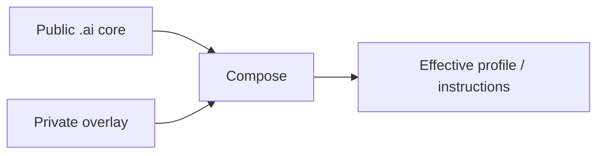

<div align="center">

# `.ai`

**Portable AI core for profiles, overlays, provider adapters, reusable instructions and skills.**

[](https://github.com/trvny/.ai/actions/workflows/validate.yml)
[](https://spdx.org/licenses/ISC)
<a href="https://deepwiki.com/trvny/.ai"></a>

[**Submodule guide**](docs/submodule.md) · [**Example overlay**](examples/profile.overlay.yaml) · [**Schema**](schema/style-profile.schema.json)

</div>

---

## Public core, private overlay

`.ai` keeps reusable AI configuration in one public place while downstream repositories keep their own private or project-specific differences.



Later layers win. Reusable changes go upstream; local differences stay downstream. No reverse synchronization is needed.

## Layout

```text
.ai/
├── AGENTS.md      canonical repository guidance
├── CLAUDE.md      symlink -> AGENTS.md
├── GEMINI.md      symlink -> AGENTS.md
├── profiles/      base profiles
├── examples/      overlay examples
├── schema/        profile schema
├── tools/         composition helpers
├── tests/         core and repository contract tests
├── instructions/  reusable instructions
├── styles/        style guidance
├── templates/     project starters
├── skills/        portable opt-in skills
├── .claude/       Claude reference defaults
└── .codex/        Codex reference defaults
```

`CLAUDE.md` and `GEMINI.md` are symlinks to the canonical `AGENTS.md`, keeping one maintained source of repository guidance.

Files here are building blocks. Providers do not automatically discover or apply everything in the repository.

## Use it in another repository

The usual setup is a pinned submodule plus a local overlay:

```bash
git submodule add https://github.com/trvny/.ai.git .ai/core
cp .ai/core/examples/profile.overlay.yaml .ai/profile.yaml
```

For repositories that already use it:

```bash
git submodule update --init --recursive
```

See **[docs/submodule.md](docs/submodule.md)** for cloning, profile composition, rendering, updates and CI checkout.

## Composition

```bash
python .ai/core/tools/merge_profile.py \
  .ai/core/profiles/default.yaml \
  .ai/profile.yaml \
  --schema .ai/core/schema/style-profile.schema.json \
  --output .ai/generated/profile.yaml
```

The final composed profile is validated against the schema. Partial overlays only need to contain the values they change.

Provider-specific files remain reference defaults. Adapt or expose them where the consuming tool expects them rather than duplicating the whole core.

## Security boundary

Keep credentials, tokens, personal paths, private endpoints and machine-specific configuration out of the public core. Use environment variables, secret storage or ignored local files instead.

## Design rules

- one maintained source of truth per concern
- public core, downstream overlays
- thin provider adapters
- generated output separate from maintained input
- simple files before frameworks
- explicit behavior before hidden magic

## License

[ISC](LICENSE)

---

## 📰 Mininews

<!--README_FEED:START-->
- [PREVIEW: Reigning European Champions PSG Set for Etihad Clash with Man City](https://sports.yahoo.com/articles/preview-reigning-european-champions-psg-212500451.html)
- [Russo and Wiegman hail ruthless England performance as Lionesses progress to face Ukraine for place at World Cup](https://sports.yahoo.com/articles/russo-wiegman-hail-ruthless-england-212500852.html)
- [“I’m Not Going to Lie” Bulldogs DB Admits He Would Want Pass Interference Called Against Georgia](https://sports.yahoo.com/articles/m-not-going-lie-bulldogs-212452679.html)
- [Karun Nair's unbeaten 81 keeps Karnataka afloat after top-order collapse against Andhra](https://sports.yahoo.com/articles/karun-nairs-unbeaten-81-keeps-212400094.html)
- [Goal crisis & in drop zone - so why is Spurs' £60m striker stuck in U21s?](https://sports.yahoo.com/articles/goal-crisis-drop-zone-why-203922875.html)
- [Two Key Takeaways After Texans’ First Win of the Season vs Titans in Week 5](https://sports.yahoo.com/articles/two-key-takeaways-texans-first-212012317.html)
<!--README_FEED:END-->

## 💬 Cytat z szuflady

<!-- markdownlint-disable MD033 -->
<!--STARTS_HERE_QUOTE_README-->
<i>❝If you gain, you gain all. If you lose, you lose nothing. Wager then, without hesitation, that He exists. — Blaise Pascal❞</i>
<!--ENDS_HERE_QUOTE_README-->
<!-- markdownlint-enable MD033 -->
