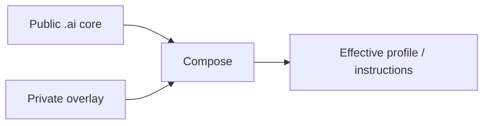

<div align="center">

# `.ai`

**Portable AI core for profiles, overlays, provider adapters, reusable instructions and skills.**

[](https://github.com/trvny/.ai/actions/workflows/validate.yml)
[](https://spdx.org/licenses/ISC)
<a href="https://deepwiki.com/trvny/.ai"></a>

[**Submodule guide**](docs/submodule.md) · [**Example overlay**](examples/profile.overlay.yaml) · [**Schema**](schema/style-profile.schema.json)

</div>

---

## Public core, private overlay

`.ai` keeps reusable AI configuration in one public place while downstream repositories keep their own private or project-specific differences.



Later layers win. Reusable changes go upstream; local differences stay downstream. No reverse synchronization is needed.

## Layout

```text
.ai/
├── AGENTS.md      canonical repository guidance
├── CLAUDE.md      symlink -> AGENTS.md
├── GEMINI.md      symlink -> AGENTS.md
├── profiles/      base profiles
├── examples/      overlay examples
├── schema/        profile schema
├── tools/         composition helpers
├── tests/         core and repository contract tests
├── instructions/  reusable instructions
├── styles/        style guidance
├── templates/     project starters
├── skills/        portable opt-in skills
└── .claude/       Claude reference defaults
```

`CLAUDE.md` and `GEMINI.md` are symlinks to the canonical `AGENTS.md`, keeping one maintained source of repository guidance.

Files here are building blocks. Providers do not automatically discover or apply everything in the repository.

## Use it in another repository

The usual setup is a pinned submodule plus a local overlay:

```bash
git submodule add https://github.com/trvny/.ai.git .ai/core
cp .ai/core/examples/profile.overlay.yaml .ai/profile.yaml
```

For repositories that already use it:

```bash
git submodule update --init --recursive
```

See **[docs/submodule.md](docs/submodule.md)** for cloning, profile composition, rendering, updates and CI checkout.

## Composition

```bash
python .ai/core/tools/merge_profile.py \
  .ai/core/profiles/default.yaml \
  .ai/profile.yaml \
  --schema .ai/core/schema/style-profile.schema.json \
  --output .ai/generated/profile.yaml
```

The final composed profile is validated against the schema. Partial overlays only need to contain the values they change.

Provider-specific files remain reference defaults. Adapt or expose them where the consuming tool expects them rather than duplicating the whole core.

## Security boundary

Keep credentials, tokens, personal paths, private endpoints and machine-specific configuration out of the public core. Use environment variables, secret storage or ignored local files instead.

## Design rules

- one maintained source of truth per concern
- public core, downstream overlays
- thin provider adapters
- generated output separate from maintained input
- simple files before frameworks
- explicit behavior before hidden magic

## License

[ISC](LICENSE)

---

## 📰 Mininews

<!--README_FEED:START-->
- [Chwila nieuwagi na ulicy Matejki. Policja ukarała 39-latkę - Przelom.pl](https://news.google.com/atom/articles/CBMiqAFBVV95cUxOYWVucmkycVFvSGk3cS0ydXc2dXFtelNHY3VNMU5RRU42RlpRbjNvYndldjVIenJXU1c4V0o1eC00MWtsMkc2LUZNLW9XRUx3VzItYV9VV28xeXE0RHMyQTR6NUlzVzZnVXl3Z2NoT0ZLenNmRnBQUVVkdktaOGp2clROQ1U4cjZEWGdmaFpLODNYSUdLOUZhby02aTFkanBCSHNkNll3M2o?oc=5)
- [kanarek-companion created review 5537758476 on PR #170 in travnie/Kanarek](https://github.com/travnie/Kanarek/pull/170?feedseek_event=17342195699#pullrequestreview-5537758476)
- [gptomek created review 5537630750 on PR #170 in travnie/Kanarek](https://github.com/travnie/Kanarek/pull/170?feedseek_event=17341748350#pullrequestreview-5537630750)
- [Volvo Cars expands automated driving partnership with Nvidia](https://www.reuters.com/business/autos-transportation/volvo-cars-expands-automated-driving-partnership-with-nvidia-2026-10-15/)
- [Kolej wróci na trasę Trzebinia–Wadowice? Jest nowa deklaracja i ważny ruch PKP PLK - Przelom.pl](https://news.google.com/atom/articles/CBMivgFBVV95cUxQM3J3Y2VQblVnQ3NPR1hsdEVuSmNKd0JURWNIQkRyNkZsa2lWNHVIQWNTX3NZY3ZJWURvMm0xZ1lzYlRjM0gzNEY0aHYyNlF1MmNST3lmS2ExX3M2cnFPSFZCcHhyU1ZVYW1oNXZ5ZDNJVGluN0xWQTllZUhleURpNVBHMTZrSHJqcTI1NmRZVnhkUnNXc1JrZkxwV1VFTElOcERCdWpqbDdaWU5CVjdsX2VubEVDbEpsdS0tb1dR?oc=5)
- [gptomek created review 5537371072 on PR #168 in travnie/Kanarek](https://github.com/travnie/Kanarek/pull/168?feedseek_event=17340832619#pullrequestreview-5537371072)
<!--README_FEED:END-->

## 💬 Cytat z szuflady

<!-- markdownlint-disable MD033 -->
<!--STARTS_HERE_QUOTE_README-->
<i>❝“Perl: The only language that looks the same before and after RSA encryption.”— Keith Bostic❞</i>
<!--ENDS_HERE_QUOTE_README-->
<!-- markdownlint-enable MD033 -->
