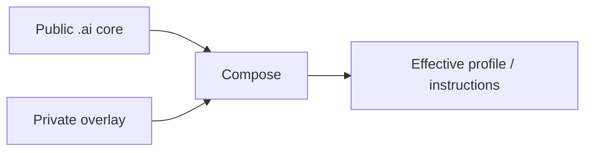

<div align="center">

# `.ai`

**Portable AI core for profiles, overlays, provider adapters, reusable instructions and skills.**

[](https://github.com/trvny/.ai/actions/workflows/validate.yml)
[](https://spdx.org/licenses/ISC)
<a href="https://deepwiki.com/trvny/.ai"></a>

[**Submodule guide**](docs/submodule.md) · [**Example overlay**](examples/profile.overlay.yaml) · [**Schema**](schema/style-profile.schema.json)

</div>

---

## Public core, private overlay

`.ai` keeps reusable AI configuration in one public place while downstream repositories keep their own private or project-specific differences.



Later layers win. Reusable changes go upstream; local differences stay downstream. No reverse synchronization is needed.

## Layout

```text
.ai/
├── AGENTS.md      canonical repository guidance
├── CLAUDE.md      symlink -> AGENTS.md
├── GEMINI.md      symlink -> AGENTS.md
├── profiles/      base profiles
├── examples/      overlay examples
├── schema/        profile schema
├── tools/         composition helpers
├── tests/         core and repository contract tests
├── instructions/  reusable instructions
├── styles/        style guidance
├── templates/     project starters
├── skills/        portable opt-in skills
├── .claude/       Claude reference defaults
└── .codex/        Codex reference defaults
```

`CLAUDE.md` and `GEMINI.md` are symlinks to the canonical `AGENTS.md`, keeping one maintained source of repository guidance.

Files here are building blocks. Providers do not automatically discover or apply everything in the repository.

## Use it in another repository

The usual setup is a pinned submodule plus a local overlay:

```bash
git submodule add https://github.com/trvny/.ai.git .ai/core
cp .ai/core/examples/profile.overlay.yaml .ai/profile.yaml
```

For repositories that already use it:

```bash
git submodule update --init --recursive
```

See **[docs/submodule.md](docs/submodule.md)** for cloning, profile composition, rendering, updates and CI checkout.

## Composition

```bash
python .ai/core/tools/merge_profile.py \
  .ai/core/profiles/default.yaml \
  .ai/profile.yaml \
  --schema .ai/core/schema/style-profile.schema.json \
  --output .ai/generated/profile.yaml
```

The final composed profile is validated against the schema. Partial overlays only need to contain the values they change.

Provider-specific files remain reference defaults. Adapt or expose them where the consuming tool expects them rather than duplicating the whole core.

## Security boundary

Keep credentials, tokens, personal paths, private endpoints and machine-specific configuration out of the public core. Use environment variables, secret storage or ignored local files instead.

## Design rules

- one maintained source of truth per concern
- public core, downstream overlays
- thin provider adapters
- generated output separate from maintained input
- simple files before frameworks
- explicit behavior before hidden magic

## License

[ISC](LICENSE)

---

## 📰 Mininews

<!--README_FEED:START-->
- [Operetka wróci do Młoszowej - Przelom.pl](https://news.google.com/atom/articles/CBMif0FVX3lxTE1zeVl6VHlCYlBqSlNRYU5TVGoxV19VSTU0a3FCckpiYjdUT0tMOEptNTRkLV92MzRXdUlINXIxajBRVWVvOVQzSkw3RVdCM3IxUFd5aVZETHNtOG1LN053dHRHUmEtaUZDeW5qTXJjUXl6WC1XdGFYYVZpRXJIUkU?oc=5)
- [Seniorzy z UTW ruszyli po wiedzę, zdrowie i przygodę - Przelom.pl](https://news.google.com/atom/articles/CBMirgFBVV95cUxPcGRwc1ludjBJSWFaZ0dWZ0JUUkxwczBoSWQ2cGVRUkgxb3NNWWo0ZnJqNW5Id1dyWkFCa1pZQVJRU3VmdXVkajlnZ0xsWHJFaDJrYUtMUmNFeVFta0otcFFSUS1UMlhrTXNhcHF4SExiTnJQZXY5YUtyY2xuSnFYV0ctcEhZcDR5bUFyUDZTdkpHbktDY2lIMFZSdVUyLWpSTkdfWGx4Rl93c1g2SVE?oc=5)
- [Amazon in talks to buy AI startup Decart for around $7 billion, WSJ reports](https://www.reuters.com/business/retail-consumer/amazon-talks-buy-ai-startup-decart-around-7-billion-wsj-reports-2026-10-11/)
- [W mijającym tygodniu odeszli od nas \[5 - 10 październik\] - Przelom.pl](https://news.google.com/atom/articles/CBMiogFBVV95cUxQRTFFRDRGbkVMMXI0Ym8yd2g1a3IwaXczZm1VaUpmbWRwaVdwd3Z0TWRlSWZOcW1IVUdPcGluV2VicHo2blVOREt5djFERnowR3dsSkFwN0FraV9HYUt1UEE5T3VXM1RqZG14bHNOVFhLMWUxenBFa2E5ZWpyaHROWERHUXVOZUVldnBfNWhnZnY1X0tnMjIydGQzeG9tQmF3NHc?oc=5)
- [Wiązanki i kwiaty na cmentarz Wszystkich Świętych 2026. Najpiękniejsze stroiki na cmentarz z żywych kwiatów 12.10.2026 - Dziennik Łódzki](https://news.google.com/atom/articles/CBMi8wFBVV95cUxObjFvTnNmTEh2c2ZWZGttUWJRX25MLU5sRHJJSWVlVWhQdjFvMjVjaFE3amdLd015THpMY2hjb3V3azJOY0xFQ1dRU3lQcjRRaTNZTzJBUEJYWGxOYS1TX3Y2M1N5V2dwQ2xLV0FSblkwaTVCZGFkU2xNdmNSRTY3WmRTal9COW95T1BfaE0zT2pBaENXTk9OU3JKaEwxRnpiZkcwOFBnX3h0ZnNDbTBmUTJEYm4wMVNQQ1pBckQzTE5GdHJwckl0b3hJbzBDaVJhX2ItZTZoMlJRTW5TUEJFOGtRT21udE5DSzBWeEE1LTJsdzg?oc=5)
- [At least 72 Sudanese artisanal miners killed in strike, rights monitor says](https://www.reuters.com/world/africa/least-72-sudanese-artisanal-miners-killed-strike-saturday-rights-monitor-says-2026-10-11/)
<!--README_FEED:END-->

## 💬 Cytat z szuflady

<!-- markdownlint-disable MD033 -->
<!--STARTS_HERE_QUOTE_README-->
<i>❝A programmer developed an operating system called TempleOS in Hospitalized for mental health problems, he believes that TempleOS is literally the Third Temple as biblically prophesied. Per God’s “instructions,” the OS uses a 640×480, 16 color display, and uses the language HolyC.❞</i>
<!--ENDS_HERE_QUOTE_README-->
<!-- markdownlint-enable MD033 -->
