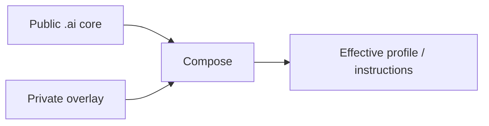

<div align="center">

# `.ai`

**Portable AI core for profiles, overlays, provider adapters, reusable instructions and skills.**

[](https://github.com/trvny/.ai/actions/workflows/validate.yml)
[](https://spdx.org/licenses/ISC)
<a href="https://deepwiki.com/trvny/.ai"></a>

[**Submodule guide**](docs/submodule.md) · [**Example overlay**](examples/profile.overlay.yaml) · [**Schema**](schema/style-profile.schema.json)

</div>

---

## Public core, private overlay

`.ai` keeps reusable AI configuration in one public place while downstream repositories keep their own private or project-specific differences.



Later layers win. Reusable changes go upstream; local differences stay downstream. No reverse synchronization is needed.

## Layout

```text
.ai/
├── AGENTS.md      canonical repository guidance
├── CLAUDE.md      symlink -> AGENTS.md
├── GEMINI.md      symlink -> AGENTS.md
├── profiles/      base profiles
├── examples/      overlay examples
├── schema/        profile schema
├── tools/         composition helpers
├── tests/         core and repository contract tests
├── instructions/  reusable instructions
├── styles/        style guidance
├── templates/     project starters
└── skills/        portable opt-in skills
```

`CLAUDE.md` and `GEMINI.md` are symlinks to the canonical `AGENTS.md`, keeping one maintained source of repository guidance.

Files here are building blocks. Providers do not automatically discover or apply everything in the repository.

## Use it in another repository

The usual setup is a pinned submodule plus a local overlay:

```bash
git submodule add https://github.com/trvny/.ai.git .ai/core
cp .ai/core/examples/profile.overlay.yaml .ai/profile.yaml
```

For repositories that already use it:

```bash
git submodule update --init --recursive
```

See **[docs/submodule.md](docs/submodule.md)** for cloning, profile composition, rendering, updates and CI checkout.

## Composition

```bash
python .ai/core/tools/merge_profile.py \
  .ai/core/profiles/default.yaml \
  .ai/profile.yaml \
  --schema .ai/core/schema/style-profile.schema.json \
  --output .ai/generated/profile.yaml
```

The final composed profile is validated against the schema. Partial overlays only need to contain the values they change.

Provider-specific files remain reference defaults. Adapt or expose them where the consuming tool expects them rather than duplicating the whole core.

## Security boundary

Keep credentials, tokens, personal paths, private endpoints and machine-specific configuration out of the public core. Use environment variables, secret storage or ignored local files instead.

## Design rules

- one maintained source of truth per concern
- public core, downstream overlays
- thin provider adapters
- generated output separate from maintained input
- simple files before frameworks
- explicit behavior before hidden magic

## License

[ISC](LICENSE)

---

## 📰 Mininews

<!--README_FEED:START-->
- [Trust but Verify: Implementing Frontier AI Policy in California and Beyond](https://carnegieendowment.org/research/2026/11/trust-but-verify-implementing-frontier-ai-policy-in-california-and-beyond)
- [Promises Made, Promises Unmet: The NPP’s Struggle to Reform Sri Lanka](https://carnegieendowment.org/research/2026/11/promises-made-promises-unmet-the-npps-struggle-to-reform-sri-lanka)
- [Castorama otwarta w Chrzanowie. Jak pierwsi klienci ocenili sklep? \(WIDEO\) - Przelom.pl - portal ziemi chrzanowskiej](https://news.google.com/atom/articles/CBMixAFBVV95cUxQdnRYUVBZMk5SenlTX25Gb1FfMW9YdnRJYnNKQ0Y5QUt6Q0Zuel9VUXBhamRHWFRIdkF3VUVFdWs0c1huZTVjV0hxeHRJc2NLY05BbmR0LTV3b0ZtZFJuLWtSNzhOQ0Y1azNQTUhYbjNLbGQ5d0ZBTDZJNUZzOHRBWUtwc2FvYWh5Q3FVOXZqUUdxdjZSam1rNWZabGNlZ0kxbHRZMU5tN2QtZUttbjE4U2VKeWowVmxUSlpEb2F2Rm9qMlUx?oc=5)
- [Uczniowie sprawdzili, ile wiedzą o Gorcach. W Chrzanowie padł rekord frekwencji - Przelom.pl - portal ziemi chrzanowskiej](https://news.google.com/atom/articles/CBMivAFBVV95cUxNZ25QYVRFRUl2RU91WkY2b2tzNlpsSjlOT3VXZEEzX2dVeUtXckFTSlZINDBmcE9SOG5GcUkwM0RFbGN3QS1mdTJmaFlVX0d4T2p4ZXFlc05FQ0xXd3JzcXdJYUdOTTJ6d00tN0F0Z1lwT2lxZUI2aFN1TlZNMktRT0lOd0o1N1RTaXMwaVg4UHk2bzI5NHFJTVVlUzhta3lmWGRlRkQzZXhpVXFkWklPLVJMcW9KWFFkNzk0cA?oc=5)
- [Google is ditching Firebase Studio soon, and it wants you to use its newer AI tools instead](https://www.engadget.com/2308541/google-is-ditching-firebase-studio-soon-and-it-wants-you-to-use-its-newer-ai-tools-instead/)
- [November 2026](https://docs.perplexity.ai/docs/resources/changelog#november-2026)
<!--README_FEED:END-->

## 💬 Cytat z szuflady

<!-- markdownlint-disable MD033 -->
<!--STARTS_HERE_QUOTE_README-->
<i>❝“It is easier to change the specification to fit the program than vice versa.”— Alan Perlis❞</i>
<!--ENDS_HERE_QUOTE_README-->
<!-- markdownlint-enable MD033 -->

## Field Guide (early preview)

The [Starlight wiki source](wiki/) adds a technical and editorial tour of the portable core. Source files in `profiles/`, `tools/`, `schema/` and `docs/` remain canonical. See [wiki roadmap](wiki/README.md).
